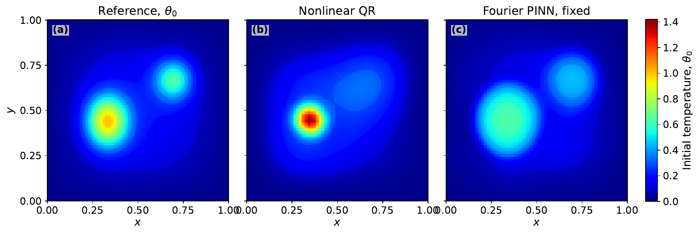
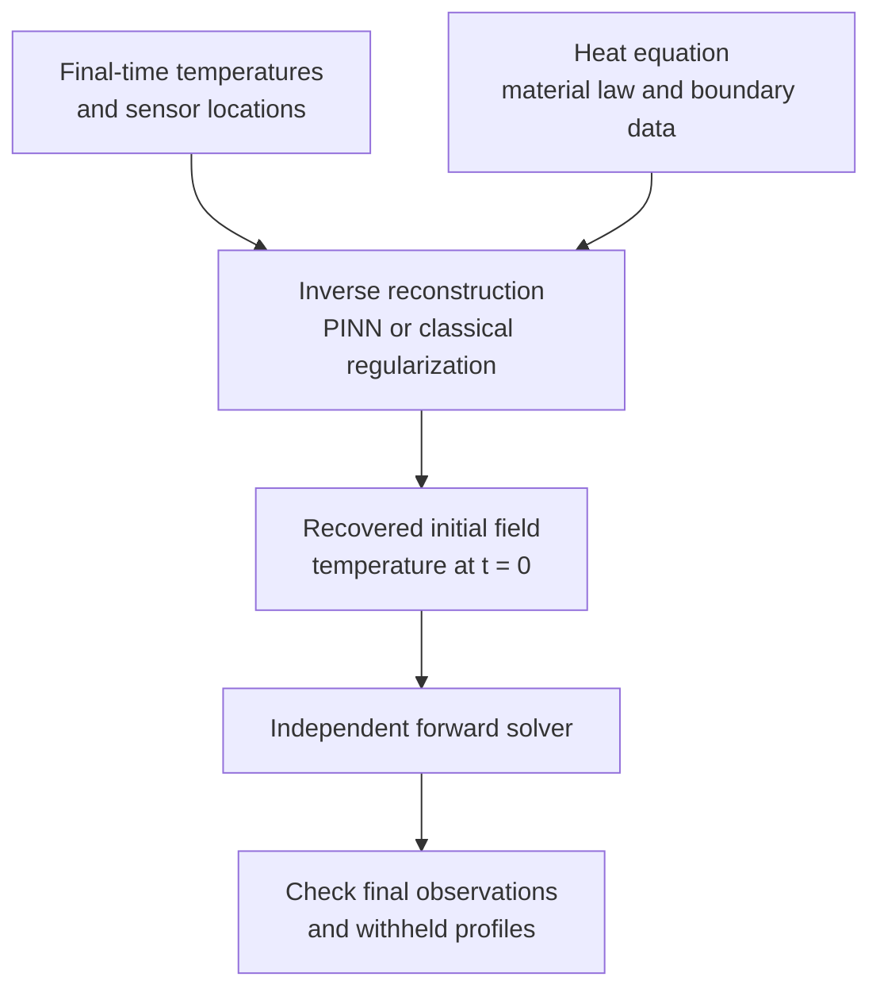
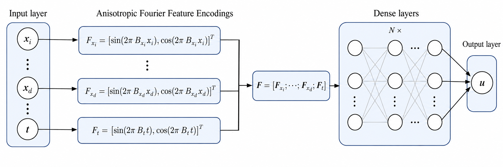
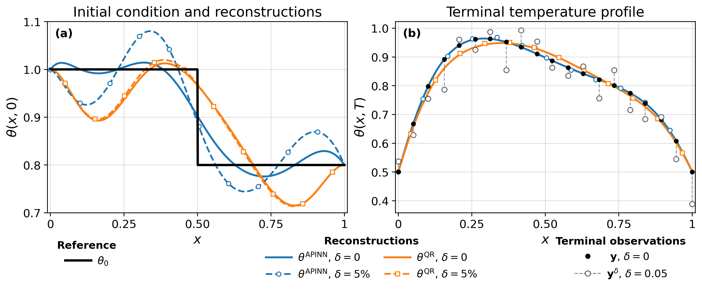
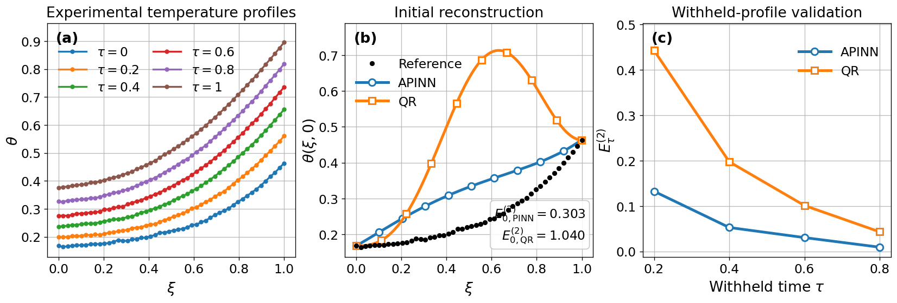
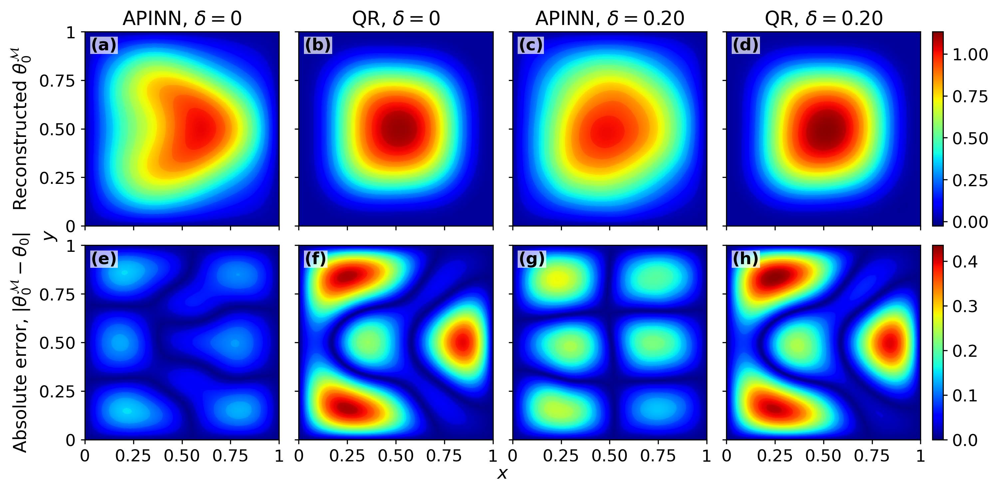
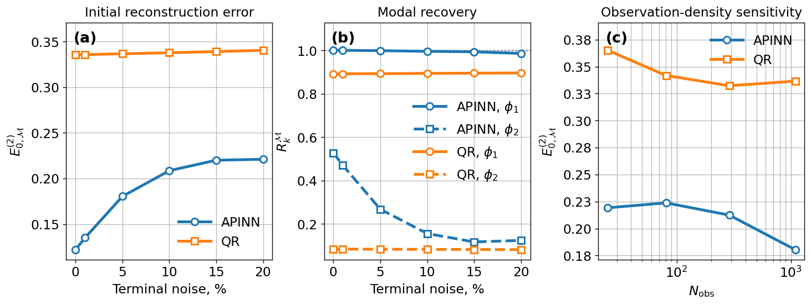
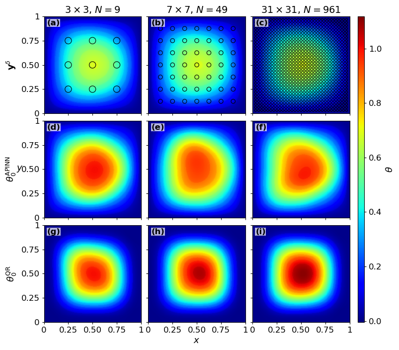

<div align="center">

<h1>Initial Temperature Reconstruction<br>with Physics-Informed Neural Networks</h1>

<p><strong>Comparison with classical methods for backward heat conduction</strong></p>

<p>
  
  
  
  
</p>

<p>K. S. Kuznetsov · E. V. Amosova · A. D. Legkiy · K. A. Korobov</p>
<p><sub>Far Eastern Federal University · Institute of Applied Mathematics FEB RAS · Vladivostok, Russia</sub></p>

<p>
  <a href="#the-inverse-problem">Problem</a> ·
  <a href="#methods-and-network-architecture">Methods</a> ·
  <a href="#results-across-four-test-cases">Results</a> ·
  <a href="#noise-and-measurement-density">Noise &amp; sensors</a> ·
  <a href="#quick-start">Quick start</a> ·
  <a href="README_RU.md">По-русски</a>
</p>

</div>

Heat diffusion smooths a temperature field as time passes. This project asks the reverse question: **how much of the initial temperature distribution can we recover from a later measurement?**

The repository accompanies the manuscript *Initial Temperature Reconstruction Using Physics-Informed Neural Networks: Comparison with Classical Methods*. It contains executable notebooks, numerical implementations, selected input data and saved research results for linear and nonlinear inverse heat-conduction problems.



*Two localized hot spots reconstructed from final-time measurements with nominal 5% noise. Left: prescribed initial field. Center: nonlinear quasi-reversibility (QR). Right: Fourier PINN with fixed loss weights. All panels use the same temperature scale. This nonlinear 2D comparison uses one neural initialization per method and condition.*

### Research at a glance

| Linear 2D | Nonlinear 2D | Brass experiment |
|:--|:--|:--|
| **TSVD: 0.0190 ± 0.0050** | **Fourier PINN, fixed: 0.222** | **Plain PINN: 6.62 ± 0.28 K** |
| Lowest initial relative L² error at 5% noise | Lowest initial relative L² error among tested methods at 5% noise | Lowest initial-profile RMSE among tested PINNs |
| Known sine eigenbasis; repeated comparison | Temperature-dependent diffusivity; single-run comparison | Digitized measurements; three initializations |

The method ranking changes with the problem. Fourier features improve recovery of attenuated spatial structure in the linear test and give the best tested nonlinear 2D result, while the plain PINN is most accurate on the brass dataset. Adaptive loss weighting does not improve every case.

## The inverse problem

Temperature evolves according to the nondimensional heat equation

$$
\frac{\partial\theta}{\partial t}
-\mathrm{Fo}\nabla\cdot\bigl(a(\theta,\mathbf{x})\nabla\theta\bigr)
=f(\mathbf{x},t).
$$

The material law, source term and boundary conditions are prescribed. The unknown is the initial field $\theta_0(\mathbf{x})=\theta(\mathbf{x},0)$; the inverse data are temperatures $y_i$ observed at the final time $T$ at a finite set of sensor locations.



In the main comparisons, every method receives the same **interior observations**. Boundary temperatures are imposed separately. The initial reference field is withheld from the inverse data term and from regularization-parameter or checkpoint selection. Independent forward integration checks whether the recovered initial field evolves consistently with the measurements.

## Methods and network architecture

The study separates the effects of input encoding and loss weighting.

| Method | Representation or regularization | Where it is compared |
|:--|:--|:--|
| Plain PINN | Normalized coordinates and a fully connected temperature network | Linear 2D, nonlinear 1D and 2D, brass |
| Fourier PINN, fixed weights | Random sine/cosine input features; fixed PDE and boundary weights | Linear 2D, nonlinear 2D, brass |
| Fourier PINN, adaptive weights | The same Fourier input map; adaptive PDE and boundary weights | Linear 2D, nonlinear 1D and 2D, brass |
| Spectral Tikhonov | Penalized inversion in a 144-mode sine basis | Linear 2D |
| Spectral TSVD | Truncated singular-value inversion in the same basis | Linear 2D |
| Quasi-reversibility (QR) | A fourth-order stabilizing term, implemented as a mixed finite-element system | Nonlinear 2D and historical comparison studies |
| Regularized nonlinear fit | 17 piecewise-linear initial-profile coefficients and a nonlinear forward solver | Nonlinear 1D |



*Each spatial coordinate and time is mapped to sine and cosine features with Gaussian frequencies. The concatenated features enter one temperature network. Evaluating the network at $t=0$ gives the reconstructed initial field. Original architecture illustration supplied with the manuscript.*

The PINN objective combines the equation residual, boundary residual and final-time data mismatch:

$$
\mathcal{J}=\eta_r^2\mathcal{J}_r+\eta_b^2\mathcal{J}_b+\mathcal{J}_T.
$$

For fixed weights, $\eta_r=\eta_b=1$. The adaptive formulation updates the equation and boundary weights by bounded gradient ascent while optimizing the network by gradient descent; the data term retains unit weight. In the supplied figures, **APINN** denotes the adaptive-weight Fourier PINN.

Spectral Tikhonov and TSVD exploit the known linear observation operator. Their direct linear formulations are used for the linear 2D problem; the nonlinear comparisons use nonlinear QR or the regularized nonlinear initial-profile fit.

## Results across four test cases

### 1. Linear 2D: recovering spatial modes

On the unit square, the exact initial field combines two sine modes:

$$
\theta_0(x,y)=\sin(\pi x)\sin(\pi y)
+0.25\sin(2\pi x)\sin(3\pi y).
$$

The final observation time is $T=100$ and $\mathrm{Fo}=2\times10^{-4}$. Diffusion attenuates the first and second modes to approximately **67.38%** and **7.683%** of their respective initial amplitudes. Recovering the weaker second mode is therefore a useful test of reconstructed spatial detail.

| Method | Initial relative L² error: clean | Initial relative L² error: 5% noise |
|:--|--:|--:|
| Plain PINN | 0.1972 ± 0.0026 | 0.1967 ± 0.0157 |
| Fourier PINN, fixed | 0.0597 ± 0.0267 | 0.0851 ± 0.0413 |
| Fourier PINN, adaptive | 0.1429 ± 0.0298 | 0.1579 ± 0.0180 |
| Spectral Tikhonov | 2.09 × 10⁻¹⁰ | 0.1256 ± 0.0075 |
| **Spectral TSVD** | **7.32 × 10⁻¹⁴** | **0.0190 ± 0.0050** |

*PINN values are means ± sample standard deviations for three runs. Noisy classical values use three observation vectors; clean classical values use one vector. All methods in this table use the same 961 interior sensor locations.*

At 5% noise, fixed-weight Fourier encoding recovers approximately **81% of the second-mode amplitude**, compared with **23%** for the plain PINN. TSVD gives the smallest initial-field error in this test, where a known eigenbasis makes direct spectral inversion possible.

### 2. Nonlinear 2D: two hot spots and temperature-dependent diffusivity

The two-hotspot example shown at the top of this README uses the positive, bounded diffusivity law

$$
a(\theta)=1+\frac{19}{1+\exp[-12(\theta-0.5)]}.
$$

The diffusivity ranges approximately from **1.05 to 19.95** over the initial temperature range. All methods receive the same 961 interior final-time temperatures at $T=1$, with $\mathrm{Fo}=0.002$ and homogeneous Dirichlet boundary conditions.

| Method | Initial error: clean | Initial error: 5% noise | Forward sensor discrepancy: 5% noise |
|:--|--:|--:|--:|
| Plain PINN | 0.306 | 0.309 | 0.0551 |
| **Fourier PINN, fixed** | **0.211** | **0.222** | **0.0503** |
| Fourier PINN, adaptive | 0.281 | 0.286 | 0.0554 |
| Nonlinear QR, mixed P₁ | 0.314 | 0.295 | 0.1049 |

*Initial errors are relative L² norms. Forward discrepancies are measured after independent nonlinear forward propagation. Each PINN result uses one initialization and the final fixed-budget checkpoint.*

The fixed-weight Fourier PINN gives the smallest initial error and forward discrepancy among the tested methods. The QR comparison remains sensitive to discretization: mesh/time-step refinement changes its reconstructed initial field by approximately **11–12%**. These results describe the reported configurations rather than a converged or universal method ranking.

### 3. Nonlinear 1D: recovering a discontinuity

The initial profile jumps from 1.0 to 0.8 at $x=0.5$, with temperature-dependent diffusivity $a(\theta)=e^{-\theta-1}$. This case tests both global accuracy and preservation of a local transition.



*Representative APINN and QR profiles from the manuscript: initial reconstruction on the left, final-time profiles and measurements on the right. The table below reports the repeated interior-observation PINN comparison and its separate regularized nonlinear-fit baseline.*

| Method | Initial relative L² error: 5% noise | RMSE / jump height: 5% noise | 10–90% transition width |
|:--|--:|--:|--:|
| Plain PINN | **0.0450 ± 0.0064** | **0.204 ± 0.029** | 0.265 ± 0.059 |
| Fourier PINN, adaptive | 0.0476 ± 0.0074 | 0.216 ± 0.034 | **0.166 ± 0.037** |
| Regularized nonlinear fit | 0.0520 ± 0.0009 | 0.235 ± 0.004 | — |

A smaller global error does not guarantee a sharper jump. With noisy data, the plain PINN has the slightly smaller global error, while adaptive Fourier encoding gives the narrower transition. Jump-normalized errors remain around **20–22%** for the two PINNs, despite global errors of only 4–5%.

### 4. Brass: reconstruction from experimental profiles

The experimental case uses digitized profiles for a **70:30 α-brass specimen**, with length **0.034 m** and an observation interval of **9 s**, from the study by [Zhang and co-workers](https://doi.org/10.1016/j.ijheatmasstransfer.2015.12.020).

Only the **48 interior final-time temperatures** enter the inverse data term. The 48 initial interior values are withheld for reconstruction evaluation, and **192 intermediate interior values** check the subsequent forward evolution. Measured endpoint histories and the calibrated diffusivity law are prescribed.



*Left: measured profiles at six times. Center: representative adaptive Fourier PINN and QR reconstructions. Right: relative error at withheld intermediate times. The table below compares all three PINN formulations in kelvin over three initializations.*

| PINN formulation | Initial RMSE (K) | Initial MAE (K) | Signed bias (K) |
|:--|--:|--:|--:|
| **Plain** | **6.62 ± 0.28** | **6.27 ± 0.30** | **+6.27 ± 0.30** |
| Fourier, fixed | 11.05 ± 0.95 | 10.59 ± 0.89 | +10.59 ± 0.89 |
| Fourier, adaptive | 9.24 ± 0.55 | 8.87 ± 0.51 | +8.87 ± 0.51 |

All three methods overestimate the initial temperature on average. These standard deviations quantify training variability on one measured dataset; they do not include measurement, digitization or diffusivity-calibration uncertainty.

## Noise and measurement density

The manuscript also includes historical APINN/QR studies on **complete, boundary-inclusive final-time grids**: noise from 0 to 20%, and grids from 5 × 5 to 33 × 33 nodes. These are single-run sensitivity studies with different boundary preprocessing from the repeated interior-only comparisons above.



*Top row: recovered initial fields for APINN and QR, with clean and 20% noisy terminal data. Bottom row: absolute initial-field errors. This figure uses the historical complete 33 × 33 observation grid, including boundary nodes.*



*Supplementary sensitivity results: initial error versus noise, recovery of the two modal amplitudes, and initial error versus observation density. Each point is one reconstruction per method and condition. They are not additional repetitions of the primary comparison.*

<details>
<summary><strong>Explore the sensor layouts and reconstructed fields</strong></summary>



*The illustrated grids contain 9, 49 and 961 interior sensors, corresponding to complete tensor grids of 25, 81 and 1089 nodes when boundaries are counted. Top: final-time measurements. Middle: APINN reconstructions. Bottom: QR reconstructions. Noise is nominally 5%.*

The full grid study also includes 225 interior sensors on the complete 17 × 17 grid. The 5%-noise, 33 × 33 result is shared by the noise and grid studies; it is the same realization rather than an independent replicate.

</details>

For these historical studies, APINN uses all noisy grid measurements in the data loss, while QR replaces boundary measurements with the prescribed boundary temperatures before interpolation. See [data provenance](docs/DATA_PROVENANCE.md) for the distinction and the documented fourth-decimal differences between several manuscript values and archived metrics. The repository preserves the archived numerical values.

## Quick start

### Inspect the saved results without training

Python 3.11 or 3.12 is recommended. Run these commands from the repository root:

```bash
git clone https://github.com/kuznetsovks17/PINN-initial-temperature-reconstruction.git
cd PINN-initial-temperature-reconstruction

python -m venv .venv
source .venv/bin/activate
# Windows: .venv\Scripts\activate

pip install -r requirements.txt
python scripts/check_repository.py
python verify_installation.py
python scripts/paper_results.py
python scripts/legacy_noise_grid_tables.py
```

The two result-reporting scripts read saved outputs without importing TensorFlow or starting neural training. To regenerate the nonlinear 2D comparison figures from the committed arrays:

```bash
python scripts/reproduce_nonlinear2d_figure.py
```

### Run the notebooks and neural training

```bash
pip install -r requirements-training.txt
jupyter lab
```

> **Training budgets:** notebooks 03, 04, 05 and 09 have production controls enabled. Running all cells can launch substantial training if checkpoints are absent. Notebook 10 can run a QR parameter sweep. Inspect the notebook controls before execution; full trained checkpoints are not bundled.

| Workflow | Notebook |
|:--|:--|
| Observation contract and entry point | [00 · Start and observation contract](00_Start_and_observation_contract.ipynb) |
| Forward checks and modal recoverability | [01 · Forward verification](01_Forward_verification_and_recoverability.ipynb) |
| Classical baselines and QR audit | [02 · Classical baselines](02_Classical_baselines_and_QR_audit.ipynb) |
| Matched linear 2D PINN comparison | [03 · Paired inverse PINN study](03_Paired_inverse_PINN_study.ipynb) |
| Nonlinear 1D jump reconstruction | [04 · Nonlinear jump and validation](04_Nonlinear_jump_and_validation.ipynb) |
| Experimental brass reconstruction | [05 · Brass experiment](05_Brass_experiment.ipynb) |
| Result tables, figures and paper snapshot | [07 · Audit tables and figures](07_Audit_tables_figures_and_paper_freeze.ipynb) |
| Nonlinear 2D reference and observations | [08 · Strongly nonlinear 2D reference](08_Strongly_nonlinear_2D_reference.ipynb) |
| Nonlinear 2D PINN training | [09 · Strongly nonlinear 2D inverse](09_Strongly_nonlinear_2D_inverse_production.ipynb) |
| Nonlinear 2D QR and comparison | [10 · Nonlinear 2D QR](10_Strongly_nonlinear_2D_QR_production_and_comparison.ipynb) |

For the nonlinear 2D workflow, run **08 → 09 → 10**. Notebook 10 needs the reference from 08 and, for combined plots, trained outputs from 09. Historical `.edp` programs in `legacy_sources/freefem/` require FreeFEM++; their original local data paths must be configured for the execution environment.

## Computational configuration

| Setting | Synthetic PINN tests | Brass PINN tests |
|:--|:--|:--|
| Hidden layers | 4 × 30, tanh | 3 × 60, tanh |
| Fourier encoding, when used | 16 Gaussian frequencies per space/time coordinate | 16 frequencies per space/time coordinate |
| Training budget | 30,000 Adam steps | 60,000 Adam steps |
| Interior collocation points | 60,000 in 2D; 12,000 in 1D | 12,000 |
| Boundary collocation points | 8,000 in 2D; 200 in 1D | 200 |
| Precision | Float32 | Float32 |

The repeated study comprises **18 linear 2D, 12 nonlinear 1D and 9 brass neural runs**. The nonlinear 2D extension adds **6 neural runs**, one for each method/data condition. Clean repeated runs use training seeds 2026–2028; noisy runs pair them with noise seeds 3100–3102. The nonlinear 2D extension uses training seed 2026 and noisy-data seed 3100. Results use the final prescribed-budget checkpoint.

## Repository guide

```text
.
├── 00_...ipynb – 10_...ipynb    # ten selected notebooks; numbering skips 06
├── inverse_study/              # PINNs, forward solvers and regularization
├── data/                       # observations, brass data and historical studies
├── results/                    # verification data and selected solver outputs
├── published_results/          # saved tables, predictions and per-run metrics
├── legacy_sources/             # original historical Python and FreeFEM code
├── scripts/                    # repository checks, result reports and plotting
├── docs/
│   ├── EXPERIMENT_MAP.md        # manuscript-to-code correspondence
│   ├── DATA_PROVENANCE.md       # sources and observation-protocol distinctions
│   ├── SELECTION_MANIFEST.csv   # original paths and source hashes
│   ├── CURATION_QA.md           # curation checks and their scope
│   └── readme_assets/          # original manuscript illustrations for this page
├── requirements.txt            # core numerical and notebook environment
└── requirements-training.txt   # additional neural-training dependencies
```

## Reproducibility, interpretation and provenance

- **Source integrity.** Original Python and FreeFEM numerical implementations retain their supplied bytes. Notebook source cells are preserved; stored outputs and execution metadata were cleared. [Source hashes](docs/SELECTION_MANIFEST.csv) and [curation QA](docs/CURATION_QA.md) document the selection.
- **Independent checks.** Reconstructed initial fields are advanced with separate forward solvers. The repeated-run study includes replay and refinement checks for 30 synthetic and 9 brass reconstructions; 29 of the 30 synthetic cases meet the stated empirical refinement criterion. This checks forward numerical resolution rather than training convergence.
- **Comparison scope.** Three-run means and standard deviations are descriptive. The nonlinear 2D comparison has a single initialization per condition and substantial QR discretization sensitivity. Fourier encoding or adaptive weights do not offer a uniform accuracy advantage.
- **Available state.** Saved tables, predictions and selected metrics support inspection without retraining. They are not complete restorable training checkpoints. Standalone PINN training programs for every historical noise/grid sweep were not identified in the supplied archive.
- **Experimental context.** Brass profiles are digitized from the cited experiment. Their endpoint histories and calibrated diffusivity are prescribed; withheld profiles assess this reconstruction on the same dataset. Data provenance does not establish independent calibration or measurement-uncertainty estimates.
- **Figure provenance.** The illustrations are supplied manuscript figures, with one PDF figure rasterized for GitHub display. [Asset notes](docs/readme_assets/README.md) identify each source. Figures illustrate the stated experiments; numerical result tables retain their distinct observation protocols.

The repository focuses on the inverse-temperature manuscript. The separate forward Fourier-feature study, composite-material case and removed 3D extension are outside this selection. The full manuscript and supplementary PDFs are not redistributed here. No software license is bundled; no license has been inferred from public availability.

## Manuscript and experimental source

**K. S. Kuznetsov, E. V. Amosova, A. D. Legkiy, K. A. Korobov.** *Initial Temperature Reconstruction Using Physics-Informed Neural Networks: Comparison with Classical Methods.* Research manuscript, with accompanying code and selected numerical data maintained in this repository.

The brass profiles originate from **Q. Zhang, S. Lippmann, A. Grasemann, M. Zhu, M. Rettenmayr**, *Determination of temperature dependent thermophysical properties using an inverse method and an infrared line camera*, International Journal of Heat and Mass Transfer 96 (2016), 242–248. [DOI: 10.1016/j.ijheatmasstransfer.2015.12.020](https://doi.org/10.1016/j.ijheatmasstransfer.2015.12.020).

---

<div align="center">
<sub>Repository maintained by <a href="https://github.com/kuznetsovks17">kuznetsovks17</a> · <a href="docs/EXPERIMENT_MAP.md">Experiment map</a> · <a href="docs/DATA_PROVENANCE.md">Data provenance</a></sub>
</div>
